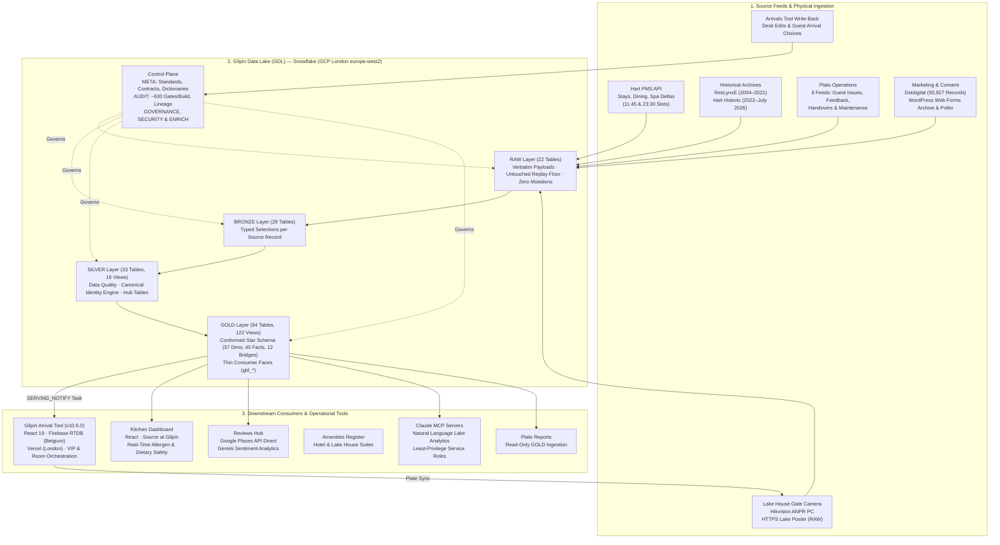

  

### *Luxury Hospitality Orchestration & Conformed Data Architecture*
**Windermere, The English Lake District · Relais & Châteaux**

 

---

 

## 🏛️ Enterprise Solution Architecture

The Gilpin technology platform provides a conformed, single source of guest truth linking 20+ years of hotel, culinary, and spa history with real-time estate sensing and front-line operational tools across **Gilpin Hotel** and the **Lake House Sanctuary**.

---

## 📦 The Technology Ecosystem

<table width="100%">
<tr>
<td width="50%" valign="top">

### 🏨 [GilpinArrivalTool](https://github.com/gilpin-hotel/GilpinArrivalTool)
*The flagship real-time guest orchestration platform.*
* **Stack:** `React 19` `TypeScript 5.7` `Vite 6` `Tailwind CSS`
* **Real-Time Synchronisation:** Firebase Realtime Database in **Belgium (`europe-west1`)** provides sub-second device-to-device synchronization for room readiness, guest arrivals, and duty manager shift diaries.
* **Edge Serving:** Vercel Serverless in **London (`lhr1`)** with HMAC-authenticated API routes.
* **PMS Integration:** Hart card-token-on-file verification at check-in, ETA write-back, and Room Confirmation 18 template management.
* **Direct Google Reviews:** Native Google Business Profile API sync without third-party scrapers.
* **Status:** **`v10.6.0 Production`**

</td>
<td width="50%" valign="top">

### 🏛️ [GDL_Merged](https://github.com/gilpin-hotel/GDL_Merged)
*The enterprise guest data platform for Gilpin Hotel & Lake House.*
* **Engine:** Snowflake on **GCP `europe-west2` (London)**.
* **Task Graph:** 113 native Snowflake tasks (111 executed per build), running twice daily at **11:45 and 23:30 Europe/London** (median runtime ~42 min). Rebuilds from `RAW`.
* **Lineage Gate:** Module `112_lineage_gate.sql` enforces rules `LIN-0` through `LIN-7` every build (no skipped layers, no backwards view dependencies).
* **Local Test Suite:** DuckDB test harness (`qa/run_local.py`) running 50/50 regression tests in seconds on laptop.
* **Privacy by Construction:** Single-commit scrubbed snapshot on GitHub with zero commit history, zero raw dumps, and pseudonymised test fixtures.

</td>
</tr>
<tr>
<td width="50%" valign="top">

### 🍳 [gilpin-kitchen-dashboard](https://github.com/gilpin-hotel/gilpin-kitchen-dashboard)
*Live culinary intelligence & food safety for Source at Gilpin Hotel.*
* **Stack:** `React` `TypeScript` `Vite` `Tailwind CSS`
* **Culinary Safety:** Subscribes to real-time dietary requirements, dining covers, and UK Top 14 allergen alerts from the Arrivals tool feed and GDL Gold views.
* **Operational Flow:** Service pacing, table recognition, cross-checked against head chef allergen runbooks.
* **Privacy:** Zero local guest PII stored; culinary operations only.

</td>
<td width="50%" valign="top">

### ⭐ [Gilpin-reviews-hub](https://github.com/gilpin-hotel/Gilpin-reviews-hub)
*Multi-channel guest sentiment analysis & reputation intelligence.*
* **Stack:** `React` `TypeScript` `Vercel Serverless (London)`
* **Intake:** Direct Google Places / Business Profile API, TripAdvisor, and Booking.com intake.
* **Gemini Intelligence:** Classifies guest reviews by department, sentiment polarity, and actionable operational insights.
* **Sync:** Shared Firebase RTDB backend with isolated path syncing live sentiment into the Arrivals Tool.

</td>
</tr>
<tr>
<td colspan="2" valign="top">

### 🌿 [gilpin-amenities](https://github.com/gilpin-hotel/gilpin-amenities)
*Comprehensive room, suite, and back-of-house asset register.*
* **Stack:** High-performance, zero-build static architecture (`HTML5`, `Tailwind CSS`, `JavaScript`) deployed to Vercel London.
* **Coverage:** Covers all 38 bedrooms (Hotel rooms 1–31 excl. 29, Lake House sanctuaries 51–58) and back-of-house areas for Plato room-mapping integration.

</td>
</tr>
</table>

---

## 🎨 Gilpin Heritage & Culinary Venues

| *The Lake House Sanctuary* | *Source at Gilpin Hotel* | *Gilpin Spice* |
| :---: | :---: | :---: |
|  |  |  |
| **Knipe Tarn & Private Spa Lodges** | **Michelin-Starred Dining** | **Pan-Asian Culinary Journey** |

---

## 🔒 Verified Governance, Security & Residency Standards

| Dimension | Architectural Fact & Verification |
| :--- | :--- |
| **Data Residency** | **100% UK & EU hosting verified.** Snowflake in London (`europe-west2`), Vercel apps in London (`lhr1`), Firebase RTDB in Belgium (`europe-west1`), Google Workspace in Europe, Plato in the UK. |
| **Snowflake AI Residency** | `CORTEX_ENABLED_CROSS_REGION` is explicitly set to **`DISABLED`**, preventing any analytical queries or LLMs from routing guest data outside the London region. |
| **Lineage Integrity** | Enforced by automated gate `AUDIT.gate_result` and module 112 every single build (`LIN-0` through `LIN-7`). |
| **Change Verification** | Every production schema migration is proven on a zero-copy clone of production before promotion (`lake standard C7`). |
| **Drift Verification** | `setup/check_stage_drift.py` asserts byte-level equivalence between Git commits, staged Snowflake code (`META.GDL_CODE`), task DAGs, and MCP hashes. |
| **UK GDPR Compliance** | Article 28 governed; Article 17 multi-layer subject erasure implemented via `META.SP_RAW_ERASE_SUBJECT` and module 103. Zero live guest PII in repositories. |

---

 

*Gilpin Hotel & Lake House · Crook Road, Windermere, Cumbria LA23 3NE*  
*Relais & Châteaux · Principal Architecture by Dimitrios Karakonstantinou*

