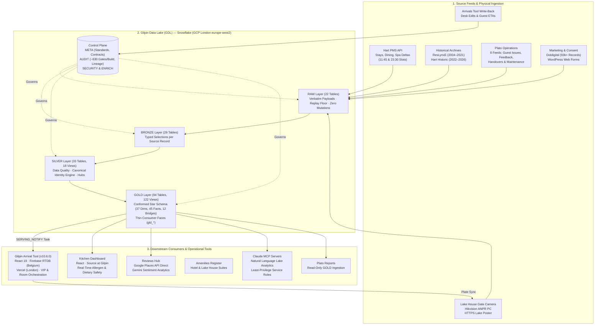

# 🌲 Gilpin Hotel & Lake House
### *Enterprise Hospitality Architecture & Intelligence Platform*
**Windermere, The English Lake District · Relais & Châteaux**

---

## 🏛️ System Architecture

The Gilpin technology platform is a unified, bi-directional hospitality intelligence network linking physical estate sensors, core property management, conformed analytics, and front-line operational dashboards across **Gilpin Hotel** and the **Lake House Sanctuary**.

---

## 📦 The Technology Repositories

### 1. [GilpinArrivalTool](https://github.com/gilpin-hotel/GilpinArrivalTool) · `Production v10.6.0`
* **Purpose:** Real-time arrival intelligence, front-of-house orchestration, and guest recognition platform.
* **Architecture:**
  - **Frontend:** React 19, TypeScript 5.7, Vite 6, Tailwind CSS.
  - **Real-Time State:** Firebase Realtime Database in **Belgium (`europe-west1`)** providing millisecond cross-device synchronization for room readiness, guest arrivals, and duty manager shift diaries.
  - **Edge Execution:** Vercel Serverless Functions in **London (`lhr1`)** with HMAC-authenticated API routes.
  - **Lake Integration:** Automated sync triggered by GDL's `SERVING_NOTIFY` post-build task.
  - **PMS & Billing Integration:** Hart PMS token-on-file verification at check-in, ETA write-backs, and Room Confirmation 18 template management.
  - **AI & Reviews:** Gemini AI arrival briefing generation and direct Google Business Profile API review fetching without third-party scrapers.

### 2. [GDL_Merged](https://github.com/gilpin-hotel/GDL_Merged) · `Governed Lake Platform`
* **Purpose:** Enterprise guest data platform unifying 20+ years of hotel, dining, and spa history into conformed single-guest truth.
* **Architecture:**
  - **Core Engine:** Snowflake on **GCP `europe-west2` (London)**.
  - **Execution Graph:** 113 native Snowflake tasks (111 executed per build), scheduled twice daily at **11:45 and 23:30 Europe/London** (runtime ~42 min). Rebuilds deterministically from `RAW`.
  - **Lineage Governance:** Module `112_lineage_gate.sql` enforces rules `LIN-0` through `LIN-7` every build (no skipped layers, no backwards view dependencies, no view-on-view gold faces).
  - **Regression Harness:** Local DuckDB test suite (`qa/run_local.py`) running 50/50 unit and semantic checks in seconds on laptop without Snowflake compute cost.
  - **Privacy by Construction:** Single-commit scrubbed snapshot on GitHub with zero commit history, zero raw dumps, and pseudonymised test fixtures (Lake Standard C9).

### 3. [gilpin-kitchen-dashboard](https://github.com/gilpin-hotel/gilpin-kitchen-dashboard) · `Production`
* **Purpose:** Real-time food safety and culinary pacing dashboard for *Source at Gilpin Hotel* (Michelin-starred dining).
* **Architecture:**
  - **Frontend:** React, TypeScript, Vite, Tailwind CSS.
  - **Data Pipeline:** Subscribes to conformed guest dietary notes and UK Top 14 allergen alerts from the Arrivals tool feed and GDL Gold views.
  - **Operational Safety:** Cross-checked against head chef allergen runbooks; zero local PII storage.

### 4. [Gilpin-reviews-hub](https://github.com/gilpin-hotel/Gilpin-reviews-hub) · `Active`
* **Purpose:** Multi-channel reputation intelligence and sentiment analysis for Hotel & Lake House.
* **Architecture:**
  - **Frontend & Serverless:** React, TypeScript, Vercel Serverless Functions (London).
  - **API Connections:** Direct Google Places / Business Profile API, TripAdvisor, and Booking.com intake.
  - **AI Classification:** Gemini AI classifies feedback into department, sentiment polarity, and actionable operational insights.
  - **Storage:** Isolated Firebase RTDB path syncing live sentiment into the Arrivals Tool.

### 5. [gilpin-amenities](https://github.com/gilpin-hotel/gilpin-amenities) · `Operational`
* **Purpose:** Comprehensive room, suite, and back-of-house asset register.
* **Architecture:**
  - High-performance, zero-build static architecture (HTML5, Tailwind CSS, JavaScript) deployed to Vercel.
  - Covers all 38 bedrooms (Hotel 1–31 excl. 29, Lake House 51–58) and plant areas for Plato room-mapping integration.

---

## 🔒 Verified Governance, Security & Residency Standards

| Dimension | Architectural Fact & Verification |
| :--- | :--- |
| **Data Residency** | **100% UK & EU hosting verified.** Snowflake in London (`europe-west2`), Vercel apps in London (`lhr1`), Firebase RTDB in Belgium (`europe-west1`), Google Workspace in Europe, Plato in the UK. |
| **Snowflake AI Residency** | `CORTEX_ENABLED_CROSS_REGION` is explicitly set to **`DISABLED`**, preventing any analytical queries or LLMs from routing guest data outside the London region. |
| **Lineage Integrity** | Enforced by automated gate `AUDIT.gate_result` and module 112 every single build. |
| **Change Verification** | Every production schema migration is proven on a zero-copy clone of production before promotion (`lake standard C7`). |
| **Drift Verification** | `setup/check_stage_drift.py` asserts byte-level equivalence between Git commits, staged Snowflake code (`META.GDL_CODE`), task DAGs, and MCP hashes. |
| **UK GDPR Compliance** | Article 28 governed; Article 17 multi-layer subject erasure implemented via `META.SP_RAW_ERASE_SUBJECT` and module 103. |

---

*Gilpin Hotel & Lake House · Crook Road, Windermere, Cumbria LA23 3NE*  
*Relais & Châteaux · Principal Architecture by Dimitrios Karakonstantinou*

