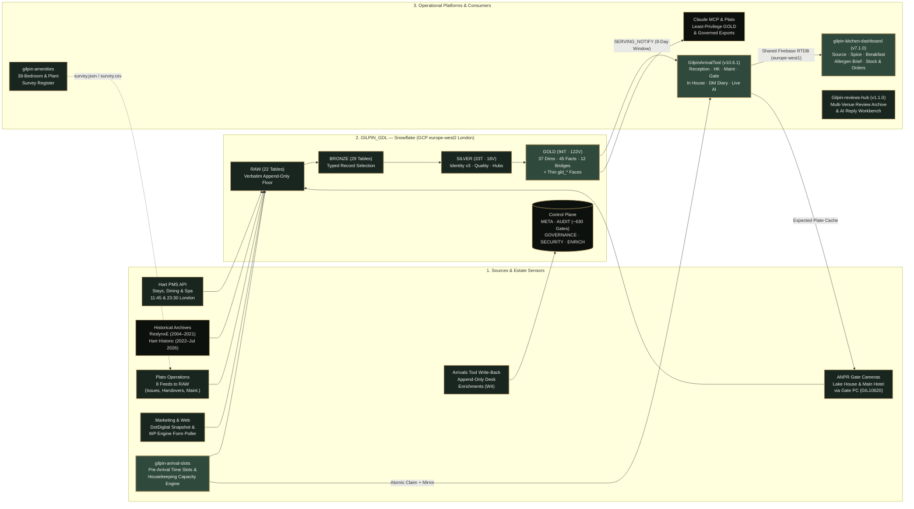

<div align="center">

<a href="#gh-light-mode-only"></a><a href="#gh-dark-mode-only"></a>

<br/><br/>

# Gilpin Hotel & Lake House
### *Enterprise Hospitality Operations & Conformed Guest Data Architecture*
**Crook Road, Windermere · The English Lake District · Relais & Châteaux**

<br/>

[](https://github.com/gilpin-hotel/GDL_Merged)
[](https://github.com/gilpin-hotel/GilpinArrivalTool)
[](https://github.com/gilpin-hotel/gilpin-kitchen-dashboard)
[](https://github.com/gilpin-hotel)
[](https://github.com/gilpin-hotel/GDL_Merged)

---

</div>

## 🏛️ Estate Technology & Data Architecture

The Gilpin technology estate joins **20+ years of guest stay, dining, and spa history** (from August 2004 to the present day) with physical estate sensing and real-time front-of-house, housekeeping, maintenance, and culinary workflows across **Gilpin Hotel** (30 bedrooms, rooms 1–31 excl. Room 29), **The Lake House** (8 suites, rooms 51–58), **SOURCE at Gilpin Hotel**, and **Gilpin Spice**.



```
════════════════════════════════════════════════════════════════════════════════════════════════════════
                             1. SOURCE INGESTION & ESTATE SENSING (11 ACTIVE FEEDS)
════════════════════════════════════════════════════════════════════════════════════════════════════════
  • Hart PMS API: Stays (GDLEXport), Dining (GDLEXportPOS) & Spa (GDLEXportSPA) — 11:45 & 23:30 London
  • Closed Historical Archives: ReslynxE (Aug 2004–Dec 2021) & Hart Historic Export (2022–Jul 2026)
  • Plato Operations: 8 feeds (Guest Issues, Feedback, Handovers + Guest Facts, Maintenance, Planned
    Maintenance, Lost Property, Accidents) landed twice daily via SVC_PLATO_INGEST
  • Marketing & Web Forms: DotDigital (subscribers, lists, suppressions) & WP Engine live form poller
  • Physical Gate Sensing: Lake House & Main Hotel Hikvision ANPR cameras via Gate PC (GIL10620)
  • Desk Write-Back: Append-only desk enrichments (ENRICH.arrivals_tool_event) & arrival-slot captures
                                                │
                                                ▼
════════════════════════════════════════════════════════════════════════════════════════════════════════
                  2. GILPIN GUEST DATA LAKE (GILPIN_GDL) — SNOWFLAKE (GCP LONDON europe-west2)
════════════════════════════════════════════════════════════════════════════════════════════════════════
  ┌─────────────────────────────┬────────────────────────────────────────────────────────────────────┐
  │  RAW LAYER (22 Tables)      │ Verbatim append-only landing floor · Replay boundary · Immutable   │
  ├─────────────────────────────┼────────────────────────────────────────────────────────────────────┤
  │  BRONZE LAYER (29 Tables)   │ Typed column selection per source record (no joins or decisions)   │
  ├─────────────────────────────┼────────────────────────────────────────────────────────────────────┤
  │  SILVER LAYER (33T, 18V)    │ Signed v3 identity engine · Note-facts parser · Shared hub tables  │
  ├─────────────────────────────┼────────────────────────────────────────────────────────────────────┤
  │  GOLD LAYER (94T, 122V)     │ Conformed Star (37 Dims, 45 Facts, 12 Bridges) + Thin gld_* Faces  │
  ├─────────────────────────────┼────────────────────────────────────────────────────────────────────┤
  │  CONTROL PLANE              │ META · AUDIT (~630 Gates/Build, LIN-0..7) · GOVERNANCE · SECURITY  │
  └─────────────────────────────┴────────────────────────────────────────────────────────────────────┘
  • Rebuilt deterministically from RAW twice daily (113 Snowflake tasks, 111 active, ~42 min median)
  • Star Contract (111 PKs, 218 FKs), Column Dictionary (1,003 columns), and Lineage Gate (module 112)
                                                │
                                                ▼
════════════════════════════════════════════════════════════════════════════════════════════════════════
                        3. OPERATIONAL PLATFORMS & SERVING SURFACES (UK / EU)
════════════════════════════════════════════════════════════════════════════════════════════════════════
         │                                       │                                       │
         ▼ (SERVING_NOTIFY + PDF Overlay)        ▼ (Shared Firebase RTDB)                ▼ (Firestore eur3 / RTDB)
  ┌───────────────────────────┐           ┌───────────────────────────┐           ┌───────────────────────────┐
  │   GilpinArrivalTool       │           │ gilpin-kitchen-dashboard  │           │ Estate Registers & Hubs   │
  │        v10.6.1            │           │          v7.1.0           │           │                           │
  │ • 8-Day Lake Window + PDF │           │ • Source, Spice &         │           │ • gilpin-amenities:       │
  │ • Reception, HK, Maint,   │           │   Breakfast Floor Plans   │           │   38-Room & BOH Register  │
  │   Turndown, In House, Gate│           │ • Automated Table Check   │           │ • Gilpin-reviews-hub:     │
  │ • Self-Updating DM Diary  │           │ • Un-Gated Allergen Brief │           │   v1.1.0 Multi-Channel    │
  │ • Gemini 3.1 Flash Live   │           │ • Read-Only Plato Recipes │           │   Review Archive & AI     │
  │   Voice/Text Relay (lhr)  │           │   & Deterministic Stock   │           │   Categoriser             │
  └───────────────────────────┘           └───────────────────────────┘           └───────────────────────────┘
```

---

## 📦 Technology Repositories

### 🏛️ [GDL_Merged](https://github.com/gilpin-hotel/GDL_Merged) · `Snowflake GCP London (europe-west2)`
* **Conformed Guest Data Lake (`GILPIN_GDL`):** Joins every stay since August 2004, every restaurant and spa booking since March 2025, marketing consent, Plato operational feeds, and ANPR gate arrivals into one deterministic guest identity per real person (`01_sql/24_identity_v3_signed_rules.sql` & household grouping module 87).
* **Four-Layer Medallion + Star Schema:** `RAW` (22 verbatim tables) → `BRONZE` (29 typed tables) → `SILVER` (33 tables, 18 views including shared hubs `guest_visit`, `guest_prep`, `guest_core`) → `GOLD` (94 tables — **37 SCD2 dimensions**, **45 facts**, **12 bridges** with 111 primary keys and 218 foreign keys — plus **122 thin `gld_*` views**).
* **Snowflake-Native Orchestration:** **113 native Snowflake tasks** (111 active per run) executing twice daily at **11:45 and 23:30 Europe/London** (~42 min median runtime), backed by failure and deadman email alerts (`GDL_TASK_ALERTS` at 01:30 and 13:30).
* **Automated Verification & Governance:** ~630 automated quality gates per build (`AUDIT.gate_result`), live lineage enforcement (`112_lineage_gate.sql` rules `LIN-0` through `LIN-7`), view performance budgets (`43_perf_gate.sql`), star-contract enforcement (`99_star_contract.sql`), local DuckDB test harness (`qa/run_local.py`), stage-drift verifier (`setup/check_stage_drift.py`), and a read-only Claude MCP server (`mcp/mcp_server.py`).

### 🏨 [GilpinArrivalTool](https://github.com/gilpin-hotel/GilpinArrivalTool) · `v10.6.1`
* **Lake-Fed + PDF Hybrid Arrival & Estate Platform:** Automatically pulls a rolling 8-day window (`T-1..T+6`) of arrivals, stayovers (`occupancy/{YYYY-MM-DD}`), 7-day briefings (`briefings/{YYYY-MM-DD}`), guest recognition tiers, prior visit counts, card-token status, and Plato maintenance/handover feeds from `GILPIN_GDL` upon `SERVING_NOTIFY`, while preserving X-coordinate PDF extraction (Hart 2026+ underscored room tokens) as a same-day overlay and standalone fallback.
* **Departmental Operational Boards:** Dedicated, role-gated views across **Arrivals**, **Check-In (Front of House)**, **In House** (38-room estate grid: 30 Main Hotel + 8 Lake House), **Housekeeping** (5-stage cleaning ladder + *Plant a Tree* 🌳 and *Cat Outside* 🐈 door signs), **Maintenance** (*Rooms Today*, *Issues*, *Plato Backlog*, *Overview*, and `?tv=1` workshop wallboard), **Turndown**, **Checkouts**, **Gate (ANPR)**, **4-Day Pre-Arrival Call Sheet**, **Handover Hub & Self-Updating DM Diary**, **Taxi Log**, and **HoD Greeter**.
* **ANPR Gate & Lock-Screen Alerts:** Receives live plate reads from on-site Hikvision cameras (`GIL10620`) at the Lake House and Main Hotel gates, matches Tier 1 (arriving/in-house) and Tier 2 (returning guest) vehicles, dispatches department-scoped Web Push phone alerts, looks up DVLA vehicle details, provides HoD/Admin full-lake plate history search (`api/gate-plate-history.ts`), and drains reads hourly to Snowflake via Snowpipe.
* **AI & Guest Experience Suite:** Two-lane Gemini refinement (`api/_refineHartLane.ts` & `api/gemini-refine.ts`), **Gemini 3.1 Flash Live** voice/text assistant via a dedicated Fly.io WebSocket relay (`lhr` London), WYSIWYG Package Itinerary Generator (*Magical Escape*, *Gilpinmoon*, *Magical Wellness Hideaway*), tri-fold Guest Bulletin, QR Digital Guest Guide (32 Lake District walks), and in-app **Operations Manual (Edition 38)**.

### 🍳 [gilpin-kitchen-dashboard](https://github.com/gilpin-hotel/gilpin-kitchen-dashboard) · `v7.1.0`
* **Culinary Operations & Food Safety Platform:** Live service, floor-plan, and stock management platform serving **SOURCE at Gilpin Hotel**, **Gilpin Spice**, **Lake House**, and **Morning Breakfast**.
* **Five Operational Views (`src/config/views.ts`):**
  1. **Source:** Interactive floor plan across Source's three rooms, 2-hour turn timeline, lunch & dinner service lists, pass view, and automated **Table Check** (detects Hart double-booked tables across sittings and offers free tables).
  2. **Spice:** Dedicated floor plan, turn timeline, lunch & dinner service management, and Table Check for *Gilpin Spice*.
  3. **Breakfast:** Morning seating and floor plan built from the lake's prior-night in-house list (Main Hotel 30 rooms vs. Lake House 8 suites), group table laying, room-service send-ups, and Room Only (`RO`) flags.
  4. **Brief:** Daily kitchen brief composed automatically from the Arrivals Tool & Guest Data Lake (`briefings/{date}`, `occupancy/{date}`, `sessions/*`), surfacing **un-gated UK Top 14 allergen & dietary alerts** to every kitchen role, Main vs. Lake House cover splits, and confidential server-side inspector watchlist checks (`POST /api/check-inspectors`).
  5. **Stock:** Per-kitchen stock management (**Main Hotel**, **Gilpin Spice**, **Lake House**) covering **Recipes** (read-only from Plato, the system of record per `PLATO_RECIPES_CONTRACT.md`), **Items**, **Count** (timestamped shelf counts), **Orders** (deterministic calculation from lake covers × menu recipe uptake ÷ batch portions − shelf stock, rounded to supplier packs, with chef-approved Resend emails via `POST /api/send-email`), and **Suppliers**. Calls **zero AI providers**.

### 🕰️ [gilpin-arrival-slots](https://github.com/gilpin-hotel/gilpin-arrival-slots) · `Pre-Arrival Time Slots & Capacity Engine`
* **Staggered Guest Arrivals & Housekeeping Section Capacity:** Sends guests a D-2 Hart email (`Room Confirmation 18` for **Gilpin Hotel**; `Room Confirmation 17` for **Gilpin Lake House**) linking to `https://arrive.thegilpin.co.uk/arrive/$$ID$$#$$Surname$$` (where the surname stays in the browser fragment and never enters HTTP GET logs).
* **Agreed Housekeeping Rules (`spread-2026-10` & `agreed-2026-10`):** Pure decision engine (`utils/arrivalSlots/engine.ts` + `policy.ts`) enforcing section caps across **S1 (`1–6`)**, **S2 (`7–14`)**, **S3 (`15–22`)**, and **S4 (`23–31` excl. `29`)**, a hotel-wide midday (`12:00`) cap (`hotelCaps: { '12:00': 1 }`), `90 min` room turnaround calculations (blocking early check-in behind `12:00` Celebration package check-outs or desk late check-outs), and a `22:00` (`10pm`) D-1 cut-off.
* **Atomic RTDB Mirror & Data Lake Round-Trip (`eta_source = 'SLOT'`):** Commits claims atomically to `arrivalSlots/days/<date>/claims`, mirrors `eta` + `arrivalSlot` to the live Arrivals Board (`sessions/<date>`) and Room Board (`Ready by <HH:MM> · early check-in promised`), passes online vehicle registrations to the ANPR desk overlay (`T1B_PROFILE`), and lands captures in `RAW.raw_prearrival_capture` on the lake's post-build notification (`META.SP_NOTIFY_SERVING`). Includes the self-contained interactive browser showcase (`demo/`).

### 🌿 [gilpin-amenities](https://github.com/gilpin-hotel/gilpin-amenities) · `Live Estate Register`
* **38-Bedroom & Back-of-House Inventory:** Shared, real-time register of every amenity, fixture, and plant item across all **38 estate bedrooms** (Main Hotel rooms 1–31 excl. 29; Lake House suites 51–58) and **Back-of-House** plant/boiler areas.
* **Zero-Build Architecture & Plato Export:** Single-page static web application (`index.html`) deployed on Vercel (`lhr1`), backed by Firebase Auth, Cloud Firestore in **EU (`eur3`)** (`rooms` and `changelog` collections with ~1s auto-save and offline persistence), and Cloud Storage (`US-EAST1`, strictly hardware/fixture photos only — zero guest PII). Exports a self-contained `survey.json` + `survey.csv` + resized photo archive for **Plato** room-mapping handoff (`SCHEMA.md`).

### ⭐ [Gilpin-reviews-hub](https://github.com/gilpin-hotel/Gilpin-reviews-hub) · `v1.1.0`
* **Multi-Venue Review Archive & Sentiment Classifier:** Internal review-intelligence application across 4 estate venues (`hotel`, `lakehouse`, `source`, `spice`) backed by an isolated Firebase RTDB partition (`reviewLake/reviews/*` in `europe-west1`) and Vercel Functions pinned to **London (`lhr1`)**.
* **Classification & Analytics:** Ingests Google, TripAdvisor, and Booking.com review datasets (via JSON/CSV/paste or seed import), classifies department, type, sentiment polarity (1–5), topics, and actionability via **Gemini 2.5 Flash** (`responseSchema` JSON mode with a 3-tier retry ladder), drafts responses in the Gilpin voice (`/api/reply-draft`), and provides **Inbox**, **Reviews**, and **Insights** views plus 2-sheet `.xlsx` export. *(Note: Since 20 Oct 2026 in `GilpinArrivalTool` `v10.6.0`, live DM Diary morning-briefing reviews are sourced directly from Gilpin's Google Business Profile listings via `api/_reviewsSource.ts`, while this repository preserves the standalone review archive and analytics hub.)*

---

## 🎨 Estate & Culinary Venues

<div align="center">

| The Lake House Sanctuary | SOURCE at Gilpin Hotel | Gilpin Spice |
| :---: | :---: | :---: |
| <a href="https://thegilpin.co.uk/lake-house/"></a> | <a href="https://thegilpin.co.uk/eat-drink/source/#gh-light-mode-only"></a><a href="https://thegilpin.co.uk/eat-drink/source/#gh-dark-mode-only"></a> | <a href="https://thegilpin.co.uk/eat-drink/spice/#gh-light-mode-only"></a><a href="https://thegilpin.co.uk/eat-drink/spice/#gh-dark-mode-only"></a> |
| **Private Lake & Spa Sanctuary**<br/><sub>8 Exclusive Suites (Rooms 51–58) on Knipe Tarn<br/>Private Boathouse, Indoor Pool &amp; The Jetty Spa</sub> | **Michelin-Starred Fine Dining**<br/><sub>Head Chef Kevin Scanlan<br/>Hyper-Local Cumbrian Produce &amp; Modern Technique</sub> | **Pan-Asian Culinary Journey**<br/><sub>Head Chef Ralph Rojas<br/>Vibrant Open Kitchen &amp; Spice Trail Sharing Menus</sub> |

</div>

---

## 🔒 Verified Governance, Security & Residency Posture

Every statement below reflects the verified live state recorded in `01_SOLUTION_ARCHITECTURE.md` (20 Oct 2026) and `HOSTING_REGISTER_2026-10-12.md` (12–19 Oct 2026):

| Dimension | Verified Architectural Posture |
| :--- | :--- |
| **Guest Data Lake (`GILPIN_GDL`)** | **Snowflake on GCP London (`europe-west2`).** All stages are internal (`RAW.STG_ANPR_READ`, `RAW.STG_ANPR_READ_V1`, `META.GDL_CODE`, `META.GDL_MCP`, `BRONZE.STG_HART`); no external storage integrations and no cross-region replication. |
| **Operational Realtime State** | **Firebase Realtime Database in Belgium (`europe-west1`).** Both live and preview instances are pinned to `europe-west1`; Upstash Redis rate-limiter primary is pinned to `europe-west1` (Belgium) with zero read replicas. |
| **Serverless Edge Compute** | **Vercel Serverless Functions in London (`lhr1`).** Arrivals (`GilpinArrivalTool`), Kitchen (`gilpin-kitchen-dashboard`), Reviews (`Gilpin-reviews-hub`), and Amenities (`gilpin-amenities`) are all pinned to `lhr1`. |
| **Live Voice/Text Relay** | **Fly.io in London (`lhr`).** `ws-relay` (`fly.toml` `primary_region = 'lhr'`) proxies Gemini 3.1 Flash Live audio/text streams with guest context held in memory only. |
| **Amenities Register Storage** | **Cloud Firestore in EU (`eur3`) & Cloud Storage (`US-EAST1`).** Room and plant records reside in `eur3`; `US-EAST1` bucket holds strictly hardware/fixture photographs with zero guest PII. |
| **Data Quality & Lineage Gates** | **~630 automated gates per build** logged to `AUDIT.gate_result`. Module `112_lineage_gate.sql` verifies Snowflake object lineage against rules `LIN-0` through `LIN-7` on every build. |
| **Clone Proof & Drift Controls** | Schema changes are proven on a zero-copy clone of production before release (`Lake Standard C7`). `setup/check_stage_drift.py` verifies byte-level parity across Git, `META.GDL_CODE`, the 113-task graph, and the MCP bundle. |
| **Consent, Masking & Erasure** | Strict opt-in marketing posture (`SILVER.guest_consent`, enforced by gate `VAL-7`); subject erasure across `RAW` and downstream layers via `META.SP_RAW_ERASE_SUBJECT` (module 103); 4 interim masking policies defined in `SECURITY` (currently detached during UAT per `META.governance_switch`). |

---

<div align="center">

<a href="#gh-light-mode-only"></a><a href="#gh-dark-mode-only"></a>

<br/><br/>

<a href="https://www.relaischateaux.com/gb/united-kingdom/gilpin-cumbria-windermere">
  
</a>

<br/><br/>

*Gilpin Hotel & Lake House · Crook Road, Windermere, Cumbria LA23 3NE*  
*Relais & Châteaux · Principal Architecture by Dimitrios Karakonstantinou*

</div>
